<table width="100%" border="1" bordercolor="#31536e" cellpadding="8" cellspacing="0">
  <tr>
    <td colspan="3" align="center" bgcolor="#05080d">
      
    </td>
  </tr>
  <tr>
    <td width="33%" align="center" bgcolor="#080d14">
      
    </td>
    <td width="34%" align="center" bgcolor="#080d14">
      
    </td>
    <td width="33%" align="center" bgcolor="#080d14">
      
    </td>
  </tr>
</table>

